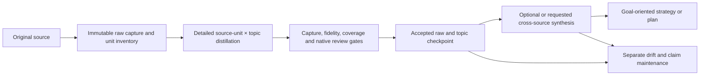

# Wiki family user manual

## Operating boundary

Four skills share one deterministic native runtime. They do not execute a second inline workflow when the runtime, safe native route, evidence or review is unavailable. Source/private-fixture checks do not establish native qualification or installed acceptance. A blocked result is not permission to change backend, create a fresh artifact or reset a spent allowance.

Use only sources and vaults you are authorized to access. This workflow neither grants account access nor retrieves DRM-protected content by bypassing controls. Native authentication, approved filesystem restrictions and existing service/target holds remain in force.

This public distribution does not claim native end-to-end qualification on your machine. It requires the shared runtime and its accepted native declarations/readiness evidence; packaging alone does not provide those prerequisites. Codex task workers remain disabled where the runtime declaration does not enable them. Delivered semantic FAIL and NO_REVIEW stop at their gates; see [recovery limitations](#recovery-limitations). There is no standalone fallback skill or private engineering recovery API in this distribution.
OMP's explicit skill command is `/skill:<skill-name>` (for example `/skill:wiki`); the public names below remain identical across hosts. Natural-language discovery uses each front's description. Only command spelling differs; every host submits the same runtime JSON contract.


## Quickstart

These are synthetic examples; `ExampleObs` is an invented configured selection key and `C:/example/` is an invented local input root.

| Intent | Invocation |
|---|---|
| Adopt existing wiki controls without ingesting content | `/skill:wiki --init --vault ExampleObs` |
| Initialize a vault without a schema | `/skill:wiki --init --vault ExampleObs --wiki-name ExampleObs --domain examples` |
| Capture a document and detailed topic knowledge | `/skill:wiki C:/example/notes.txt --vault ExampleObs --title "Example notes" --topic example-topic --domain examples --no-compile` |
| Preview ingestion without state or vault changes | `/skill:wiki C:/example/notes.txt --vault ExampleObs --title "Example notes" --topic example-topic --domain examples --dry-run` |
| Synthesize what accepted sources say about a topic | `/skill:wiki-compile "examples: research-methods" --vault ExampleObs` |
| Derive a goal-oriented plan from accepted synthesis | `/skill:wiki-strategize "examples: improve research reproducibility" --type plan --vault ExampleObs` |
| Check monthly source drift | `/skill:wiki-reverify --vault ExampleObs` |
| Reassess selected note claims | `/skill:wiki-reverify --mode content_check --slugs note-one,note-two --vault ExampleObs` |

`--dry-run` is a preview, not an accepted ingestion or verification. It resolves and reads available inputs and describes planned paths/decisions, with no state.db creation/migration, native task/review, vault/audit write or network mutation. Pending acquisition or authorization that cannot be performed read-only is disclosed, not invented.

Run one workflow at a time in each project. `OWNER_BUSY` means another controller holds that project's lock; wait for its run to finish rather than launching copies. Independent vaults can use separate project directories.

## Evidence layers



Raw capture preserves evidence, not generated analysis. Topic distillation keeps useful detail, numbers, qualifications and direct raw citations rather than replacing a source with an executive summary. Cross-source synthesis distinguishes agreement, contradiction, scope and grounded inference. Three raw files do not by themselves prove three independent origins.

Original source citations and annotation remain preserved evidence under the [Source Note contract](../canonical-schema.md#source-note-frontmatter-contract), not new pipeline claims requiring self-citation. This does not establish transcription fidelity or skip native capture acceptance; generated topic knowledge still requires its own exact supporting citations.


Both distillation and synthesis use the schema's compilation type with different `artifact_role` values. A `topic_distill` is not accepted `synthesis`; the latter is required for goal-oriented outputs. Old Markdown or a matching frontmatter type is not an acceptance receipt.

## Vault selection and controls

Pass `--vault <configured-name-or-absolute-path>` to avoid ambiguity. Names resolve through the existing Obsidian vault resolver and its configured `VAULT_<NAME>_LOCATION` values; do not synthesize another machine's private paths. Omitted ingestion selection requires an unambiguous configured default; use an explicit value if the resolver cannot select one. Maintenance always requires `--vault`.

The root `.wiki-schema.md` is the sole per-vault authority for canonical pin, paths, taxonomy, permitted tiers, status and custody. The selection key, emitted `wiki_name`, local schema revision and canonical version are distinct. Canonical3.1 is shipped alongside the frozen3.0 resource; existing3.0 pins are not automatically migrated. Missing YAML support, conflicting/unsafe declarations, traversal or root/identity conflicts block before content work.

`/skill:wiki --init --vault ExampleObs` creates or adopts permitted controls only. It preserves custom text, CRLF and outside-managed-region bytes, existing pins, raw evidence and corpus placement. Template path declarations are not permission to scaffold topics/strategies or move content. The resolved hub (normally `_hub.md`) and a separate `index.md` catalog are distinct roles; reference navigation is protected. Human-edited, hand-curated, locked, foreign-managed or unenrolled controls are skipped/proposed/refused with exact receipts rather than overwritten or reported as updated.

Facts-only/no-Tier-C vaults reject strategy, inference, strategy-card and plan before worker dispatch. A type flag, raw fallback or alternate output path cannot bypass that policy.

### Finite control adoption

For a separately reviewed control-only operation, use the installed direct-file CLI. Write a private request outside the vault with exactly these fields; paths below are invented examples, not machine defaults:

```json
{
  "schema_version": 1,
  "selection_key": null,
  "vault_root": "C:/example/vault",
  "project_root": "C:/example/control-project",
  "overrides": {}
}
```

Use the actual configured selection key instead of null when selecting a named vault. Overrides must be the exact reviewed control overrides, never inferred permissions to relocate content or weaken protection.

```text
<runtime-python> <installed-skills>/wiki/runtime/vault_controls.py plan --request <private-request.json> --out <private-plan.json>
<runtime-python> <installed-skills>/wiki/runtime/vault_controls.py apply --plan <private-plan.json> --receipt <private-apply.json>
<runtime-python> <installed-skills>/wiki/runtime/vault_controls.py verify --plan <private-plan.json> --receipt <private-verify.json>
```

Review the complete plan before Apply. Plan reads current controls/preservation metadata and writes its requested private plan/preimages, but does not initialize `state.db` or change the vault. Apply uses the frozen plan/run/effect IDs and expected preimages. Verify runs separately and is read-only except its requested private receipt. Protected skips remain explicit, not updated controls. After successful Verify, create a second plan at a new private path and require zero changes; do not apply it merely to obtain a no-change receipt.

Plans and receipts are immutable. Reusing an existing matching destination collects that record, not another Apply. After a blocked Apply, a new receipt destination can resume only the same still-valid plan; preserve the failed receipt. Changed runtime/graph or a reconciled partial initialization needs an explicitly linked current-runtime successor:

```text
<runtime-python> <installed-skills>/wiki/runtime/vault_controls.py plan --request <private-request.json> --out <private-successor.json> --predecessor-plan <original-private-plan.json>
```

The successor binds the original plan's exact path/hash, classifies its journalled effects and plans remaining changes from current preimages. Apply/Verify the successor through the same CLI. For an inline `--init` predecessor, retain the actual emitted `control-plan.json`; an unrelated copy is not its original journal-bound artifact. The old pipeline stays unchanged. Direct Apply of the original pipeline envelope is refused rather than creating a nested run. Unexplained effect states still block; do not edit receipts, replay old definitions or roll back human content.


## Ingestion

Syntax:

```text
/skill:wiki <source> [--vault NAME-or-path] [--depth 0|1|2] [--title TITLE] [--topic TOPIC] [--domain DOMAIN] [--source-class CLASS] [--transcript FILE-or-URL] [--no-compile] [--clickup] [--dry-run]
/skill:wiki --init --vault NAME-or-path [--wiki-name NAME --domain DOMAIN] [--dry-run]
```

When `.wiki-schema.md` is absent, `--wiki-name` and `--domain` are required; existing-schema adoption retains its declared identity. Use `--title` when an input lacks a usable title. For a supplied course/podcast/video transcript, set the corresponding `--source-class` and pass its local file or authorized HTTP(S) URL via `--transcript`.

For every ingestion modality, select a declared domain with `--domain` or a domain-qualified `--topic`, unless the schema uniquely determines one domain. Pass `--topic` unless the selected domain has exactly one declared topic; a newly initialized schema with no topics still requires an explicit topic. Missing/invalid domain returns `DOMAIN_SELECTION_REQUIRED`; missing or ambiguous ingestion topic returns `TOPIC_SELECTION_REQUIRED` rather than using a source URL/body as a topic label. These requirements also apply to previews. The examples above supply both flags so no taxonomy inference is needed.

Inputs include ordinary web/article/thread and YouTube URLs; PDF, DOCX, HTML/MHTML, text/Markdown and supported images; EPUB or an authorized Calibre book/library input, with existing conversion dependencies for supported MOBI/AZW3. Supplied text requires explicit title/topic decisions when metadata is missing. Binary extraction, OCR/vision, transcript acquisition and conversion each require their actual supported tools. An unavailable extractor/transcript/image is disclosed; generated prose never masquerades as captured bytes. Arbitrary audio transcription or account/DRM retrieval is not implied by a source class.

Missing absolute paths, explicitly relative paths (`./` or `../`), and supported document/book/image filenames fail `SOURCE_UNAVAILABLE`; `--title` does not turn a missing local-file operand into supplied text.

For course/podcast/video, supply an authorized accessible transcript when the ordinary source cannot provide one. A local transcript is hashed as a local input; an HTTP(S) transcript is fetched as an actual URL snapshot, never opened as a filename. Provenance retains supplied-file, supplied-url or youtube and its original reference so drift can repeat that method. Missing content is source-unavailable, not an invented transcript or a switch to unrelated YouTube content.

The capture inventory enumerates expected source units independently of worker success: chapters, pages/images, entities or transcript/link units. Each unit is covered, explicitly excluded by an accepted scope decision, or unavailable. Unavailable is not covered. Partial scope is explicit; an empty or truncated inventory is not complete ingestion. Images retain uncertainty and OCR-derived suspicious numbers remain flagged.

Link depth defaults to1;0 disables following and2 requests the supported additional depth. Record unfetched links explicitly. Large/ambiguous link selections require the persisted scope decision, not a silent claim of complete acquisition.

When acquisition needs an explicit partial selection, the saved decision lists exact unit IDs, selected units and each exclusion's scope rule/reason before producer work. Downstream inventory, coverage, verdicts and receipts retain that partial scope. Supply the exact offered answer when resuming; neither counts nor a worker's success can silently exclude unavailable selected material.

For authorized public web/thread inputs only, the vault's outbound_archiving policy may permit one controller-owned Wayback save. Private/local/credential-bearing inputs and outbound false produce no remote submission. The local archive is the acquired original response bytes, not generated Markdown; its stable logical reference resolves through the accepted snapshot manifest. Definite remote failure is disclosed and can retain local evidence. Unknown POST outcome blocks for exact read-only reconciliation and is never reposted. Missing/stale local mapping refuses rather than reading an arbitrary path.

The workflow orders capture/inventory validation, applicable book/index or image grouping, source-unit×topic distillation (concurrency4), fidelity/coverage verification and bounded remediation. Verifiers do not edit notes; separately authorized repairs change only identified candidate defects. Protected/combined-note dispositions remain explicit members of fan-in, not missing work hidden by equal counts.

At most three ingestion remediation iterations run within the original artifact-specific allowances. Required extraction, index, original producer-note, consolidated remediation-verdict and conditional compilation reviews have distinct stable identities. General ceilings are at most4full reviews/3repairs per evolving artifact; a narrower stage limit or delivered review failure wins even if a ceiling has room. NO_REVIEW, unreadable/unqualified evidence, contract/tool fault or delivered fail blocks; no backend switch for approval.

After the required gates, the raw/source-topic checkpoint publishes before conditional compilation. `--no-compile` skips that synthesis, not capture/coverage/review. Otherwise the workflow applies the retained topic-match/compilation policy to the accepted corpus. Missing synthesis prerequisites are reported rather than replacing a multi-source compilation with a single-source summary. L6/L7 failure does not roll back the accepted checkpoint: outputs and remaining effects are reported separately.

Finalization performs only permitted navigation/audit and this invocation's explicitly enabled actions. No alternative standalone bypass exists.

### Optional ClickUp

Only ingestion accepts one-shot `--clickup`; default is disabled and never inferred from note content. Disabled runs do not import/probe its helper, inspect auth, construct an API client or contact the service. Ordinary ingestion requires neither helper nor token. `--dry-run --clickup` describes tasks without auth/network access.

When invoking the ClickUp helper, set `CLICKUP_ROUTES_FILE` to a readable UTF-8 JSON object owned by the operator, outside the skill tree. All seven required keys below must map to nonempty strings. Replace the invented destination names with your own ClickUp list IDs; no account or list IDs are bundled:

```json
{
  "openclaw": "example-openclaw-list",
  "claude": "example-claude-list",
  "ai": "example-ai-list",
  "tech": "example-tech-list",
  "trading": "example-trading-list",
  "health": "example-health-list",
  "default": "example-inbox-list"
}
```

Routing is case-insensitive and strips surrounding whitespace/slashes. Longest listed prefixes are checked first: `tech/devtools/openclaw`, `tech/devtools/claude-code`, `tech/ai`, `tech`, `wealth`, `health`. A prefix matches itself or a slash-delimited descendant, never a partial word. Explicit configured keys match directly; unmatched topics use `default`. Missing/invalid configuration refuses only this invoked optional helper, not ordinary wiki use. A helper dry-run reads routing but neither authentication nor the network; mutation needs `CLICKUP_API_TOKEN` only on the enabled execution path. Keep the route map stable while reconciling an uncertain action, since its destination is part of the durable request identity.

Enabled execution validates its prerequisites only after accepted knowledge publication. Preserve destination routing, priority4, tags and result receipts. Each mutation has a durable intent and one POST. A retained task ID or exact URL/destination read-only reconciliation can establish the outcome; a substring lookup is not exactly-once proof. Unknown POST outcome blocks reconciliation, never automatic retry. Action failure remains separate from knowledge acceptance and cannot fabricate a task receipt or roll back notes.

Settled outcomes are returned in `action-report.json`, including disabled status, definite failures and successful receipts from a partially failed batch. A run may finish `done` while its optional action report says `failed`; inspect both. An unresolved effect remains a blocked error until reconciled and does not produce a completed action report.

## Compilation

```text
/skill:wiki-compile [--from-pipeline ID] <topic> [--domain DOMAIN] [--vault NAME-or-path] [--dry-run]
```

Select a declared domain with a topic prefix such as `"finance: risk-management"` or with `risk-management --domain finance`. A bare topic without `--domain` is valid only when the vault schema declares exactly one domain. The finance examples assume that `finance` is declared in the selected vault.

When supplied, `--from-pipeline <ID>` is first. It selects only accepted hash-bound role records published by that named run in the same project ledger and current vault manifest, before topic matching. An accepted checkpoint survives a later blocked run, but nonexistent runs, another vault, wrong roles or stale paths/hashes return `UPSTREAM_ACCEPTANCE_UNAVAILABLE`; the global corpus cannot silently replace the named handoff. The workflow gathers accepted topic distillations and complete underlying raws, requiring at least three distinct matching raw files. Lineage/independence remains separate from that count. Legacy raw-only inputs obtain missing capture/distillation acceptance within this same parent run and its counters; they are not silently promoted.

Synthesis rereads raws and keeps detailed claims, qualifications, conflicts and direct citations. Required post-generation review is separate from eligible L3 verification/review. L3 permits three verification passes and at most two verifier-driven repairs, still subject to the shared per-artifact ceiling. A verifier FAIL does not earn publication or a discriminator call on that failed draft; the final failed pass blocks. A native delivered fail blocks immediately, not after spending unused attempts.

Publication respects canonical custom paths, protection and the supersession rules below. Use ingestion for a new source and goal synthesis for a decision/plan; do not substitute one operation for another.

## Goal-oriented outputs

```text
/skill:wiki-strategize [--from-pipeline ID] <Goal> [--type strategy|inference|strategy-card|plan] [--vault NAME-or-path] [--allow-raw-only] [--dry-run]
```

Keep `--from-pipeline` first when supplied. Preserve the full Goal, usually a domain-qualified prescriptive goal. Required accepted synthesis coverage and underlying evidence are resolved before generation. Zero synthesis coverage blocks with `recommend_compile`; a topic distillation alone does not satisfy it. Raw fallback must be justified and cannot override the synthesis prerequisite or a Tier-C prohibition.

`--allow-raw-only` explicitly permits justified raw fallback in evidence gathering; despite its name it does not waive accepted synthesis, citation/raw-ratio/confidence rules or the vault's Tier-C policy.

Use vault-relative, extensionless qualified synthesis citations when basenames collide, for example `^[[[wiki/science/alpha-compilation]]]`. A bare citation is accepted only when it identifies one accepted synthesis; ambiguity cannot fall through to raw evidence.

The output keeps its selected type, reasoning chain, counter-considerations, evidence quality and falsifiable review triggers. Required post-generation and bounded fidelity/coverage/review gates retain the original identity/counters. Generic hub rewrites and ClickUp are not authorized by creating a Tier-C note. Separate claim maintenance can subsequently reassess cited support without rewriting this output.

## Maintenance

One public skill routes absent `--mode` or `drift_check` to internal `wiki-reverify`, and `content_check` to `wiki-content-check`. It consumes only `--mode` and forwards the other argv values unchanged. Unknown/conflicting mode, source operands, cross-mode flags and unknown options are invalid. No scheduler is registered and no ingestion `--check` alias is introduced.

### Source drift

```text
/skill:wiki-reverify [--mode drift_check] --vault NAME-or-path [--freshness live|weekly|monthly|quarterly|permanent|all] [--source-class CLASS ...] [--snapshot-on-drift] [--backfill-mode] [--dry-run]
```

Freshness defaults to monthly. Repeat `--source-class` to restrict the nine classes: book, course, podcast, video, thread, web, pdf, image and document.

- Books are skipped: tool/OCR/conversion variance is not silent byte drift proof.
- Course/podcast/video compare the retained transcript method with normalized Levenshtein delta. Strictly below0.05 matches; equal0.05 does not. Partial transcripts are disclosed.
- Threads use the stored archive reference, not a mutable live thread. Missing/unavailable archive is a source-unavailable result.
- Web/PDF/image/document compare the stored valid acquisition hash domain, not a source-class guess. Acquisition-byte and normalized body hashes are distinct; comparing unlike domains is invalid. Missing baselines are not recomputed into success. Ambiguous legacy provenance is disclosed in `drift-report.json` as `selection_diagnostics` rather than guessed.

Drift is a report outcome, not an execution failure. Existing raw and downstream note bodies/frontmatter stay unchanged. Explicit `--snapshot-on-drift` may create a new versioned raw after detected drift; it never overwrites v1 and still respects protection. `--backfill-mode` is signal-only: identify missing provenance, no hash baseline/content writes. No snapshot or audit is fabricated when its target is locked/unavailable.

A new transcript version compares future refetches against its own captured body, not the previous version's immutable archive. The original version and archive remain unchanged.

### Claim reassessment

```text
/skill:wiki-reverify --mode content_check --vault NAME-or-path [--slugs a,b] [--slug-file PATH] [--wildcard PATTERN] [--all] [--dry-run]
```

Selectors union/deduplicate. Slug-file is newline-separated; wildcard matches note basenames. `--apply` is rejected. Existing wiki bodies/frontmatter are read-only; no content snapshots, backfill or ClickUp occur.

Missing selected slugs are returned in `content-check-report.json` as `selector_warnings`; a zero-match count alone does not hide why selection was empty.

Claim extraction runs with limit8, page processing with limit4, claims sequentially within each page. Each claim retains an immutable identity/hash and exact raw evidence. A typed evaluation is VERIFIED, WEAKENED, REFUTED, FABRICATED or INSUFFICIENT_DATA, with actual cited span/reason and severity where applicable. A positive claim also needs a qualifying non-fail native review bound to the note, claim, raw and evaluation; empty findings alone prove nothing. Disagreement over a typed positive becomes insufficient-data with integrity escalation, not forced approval or a fabricated defect.

Each claim has at most one native review and no repair. NO_REVIEW consumes that claim's allowance, aborts the page as TOOLING_FAILURE and leaves remaining claims unreviewed. No internal relaunch, alternate-backend review or new checking run to reset the allowance. A later explicitly requested maintenance check is a distinct recorded request, never rewriting this report.

Report precedence: tooling failure first; zero claims means insufficient-data with null score; at least50% insufficient means insufficient-data; any refuted/fabricated claim, at least30% weakened, or any insufficient/integrity/unreviewed claim means needs-attention. VERIFIED requires complete review, no integrity/outer failure, no refuted/fabricated/insufficient claims and weakened below30%. Score is verified/total, except zero/tooling null. Tooling results retain null verdict counters and a separate unreviewed count. Complete negative findings are valid reports, not clean knowledge. Incomplete/tooling reports persist before the final failed outcome, after permitted audit.

### Audit versus content writes

Maintenance may append enrolled unprotected verification logs and update existing manifest operation records using one serialized writer after complete fan-in. Records distinguish drift/content axes, selected/processed/verified counts and attempt time. Only complete content fan-in with at least one verified page and no tooling or rejected-review integrity failure can refresh successful semantic `last_verified_at`. Drift, zero matches/claims and partial fan-in cannot refresh it. A clean sibling page never hides another page's rejected native review. Missing manifest or locked/unenrolled/protected log follows the explicit refusal/skip/proposal branch. An audit receipt is not a note rewrite or a semantic verification receipt.

A compatible unenrolled vault may run read-only drift/content reporting when no snapshot/content effect is requested. It explicitly returns `audit_skipped:VAULT_CONTROLS_NOT_ENROLLED` and writes no controls, manifest or audit log. This does not enroll the vault, waive claim/native gates, or permit snapshots/new knowledge writes. Inspect the report's actual findings separately from the skipped audit.

## Publication and recovery

Workers write private run candidates only. The sole publication manager checks actual names/media/subjects, hashes, schema, citations and required gates; commits operation ID, expected preimage, desired hash and candidate before touching a canonical target. Human protection and preimages are reread immediately before effects. These are recoverable per-file effects, not a global transaction or filesystem CAS against an uncooperative editor.

For compile/strategy supersession: archive the prior canonical using its last-verified date (today if unparseable), preserve creation date, link old/new through superseded_by/supersedes and do not rewrite inbound links. A definitely refused/colliding archive rename permits the retained date-suffixed new-path branch, preserving the original and reporting the canonical-link sacrifice. A conflicting new path blocks; it is not overwritten. Unknown rename outcome must be reconciled, not treated as definite refusal.

Recovery classifies actual bytes as prior, desired or conflicting. Desired reconciles without replay; prior permits only the still-authorized unperformed operation; conflicting blocks and preserves human edits. Already accepted outputs remain published when later synthesis/navigation/actions fail. No automatic rollback or replay of uncertain native submissions, renames or external mutations.

Private truth lives in the actual project's `state.db`; candidates, exact source/task/native receipts and audit evidence live under `docs/tmp/pipeline-runs/<run-id>/`. Source definitions, request/input hashes, subjects, attempts, counters, decisions and effects are immutable observations. Legacy read projections are not an alternative authority. A live owner lock refuses a competing controller; elapsed time never authorizes takeover. Legacy prose-driven nonterminal runs are not adopted/replayed by this runtime.

## Runtime request

Resolve `<installed-skills>` from the loaded skill's real location, not cwd/HOME or a source checkout. `_workflow/` is a non-discoverable sibling runtime, not another skill. Use the matching OS-hostname fleet declaration's absolute `tokens.__OMP_PYTHON__` as runtime Python. The separately declared deployment interpreter is not an implicit substitute. Native package/runtime/executable and matching readiness evidence resolve from accepted declarations/manifests; missing fields/files/capabilities fail closed. No PATH/profile/foreign-user guessing or incidental installation/upgrade.

The front observes caller host/family from actual active native session metadata. Unknown/mismatched identity blocks. Backend `auto` starts OMP; exceptional operational fallback preserves semantics, evidence and counters and never repairs a semantic FAIL or unavailable review. Existing native approval/auth restrictions stay intact. There is no same-family review substitute. Only explicitly supported execution profiles are accepted; profiles never override task semantics. Do not invent a profile or edit persistent harness configuration.

### Native admission and fallback

Before the first actually ready native task/review, the controller validates declared task-worker capability and the actual caller's review route. It freezes the admitted configuration and hash-bound source/declaration/native/qualification receipts privately once, then rechecks them on dispatch/resume. Missing, stale, wrong-target or conflicting host/family evidence blocks before reservation with `NATIVE_CAPABILITY_UNAVAILABLE`. Do not edit receipts or supply native-configuration overrides in request JSON. Purely local --init, preview, status, cancel and reports with no claim tasks need no model admission; a report that actually evaluates claims does.

`backend:auto` chooses OMP. Only an observed operational launch failure before adapter/native submission may select already-qualified restricted Claude. Missing/stale OMP readiness, permission refusal, semantic FAIL, NO_REVIEW, cancellation, unknown submission and exhausted allowance never trigger fallback. Explicit omp/claude do not fall through. An active native review keeps the discriminator's own two-hour abort deadline; task timeouts do not shorten it, and cancellation still remains responsive.

For this release, declared `workflow_native.codex.task_enabled:false` (also the default when absent) makes explicit `backend:codex` return blocked/exit2 `NATIVE_BACKEND_UNAVAILABLE` before task submission or counter reservation. The qualification row is `unavailable_by_approved_scope`, not PASS. No OS upgrade, WSL provisioning, root-read workaround, sandbox/auth repair or native Codex task probe is part of ordinary operation.

Codex and Claude remain real caller hosts for all four fronts. Their requests preserve observed caller_host/caller_family while OMP executes tasks; their reviews use the actual caller's unchanged opposite-family native launch/collect route. Worker fallback never relabels the caller or switches review routes. An unavailable review blocks that run. OMP task roots constrain instructions and controller artifacts, not an advertised OS path-grant sandbox; native approvals remain intact. Exceptional Claude retains its qualified restricted read/write boundary and existing credential-free loopback route where declared.

Write a private absolute request JSON outside the vault. Exact fields, with no extras:

```json
{
  "schema_version": 1,
  "workflow": "wiki-ingest",
  "project_root": "C:/example/project",
  "arguments": ["C:/example/notes.txt", "--vault", "ExampleObs", "--title", "Example notes", "--topic", "example-topic", "--domain", "examples", "--no-compile"],
  "caller_host": "omp",
  "caller_family": "gpt",
  "backend": "auto",
  "profile": null
}
```

The caller values above are examples, not defaults: host is `omp|codex|claude`, observed family `gpt|claude`, backend `auto|omp|codex|claude`. Workflow is exactly `wiki-ingest|wiki-compile|wiki-strategize|wiki-reverify|wiki-content-check`. Pass source/topic/goal/vault values as argv-array JSON, never interpolated shell code. The maintenance front strips only `--mode`; the chosen internal workflow receives the rest unchanged.

Common command contract:

```text
<runtime-python> <installed-skills>/_workflow/workflow.py run --request <absolute-request.json>
<runtime-python> <installed-skills>/_workflow/workflow.py status --project <absolute-project> --run <run-id>
<runtime-python> <installed-skills>/_workflow/workflow.py resume --project <absolute-project> --run <run-id> [--decision <absolute-decision.json>]
<runtime-python> <installed-skills>/_workflow/workflow.py cancel --project <absolute-project> --run <run-id>
```

Stdout is the JSON envelope `{schema_version:1,run_id,status,outputs,decision,error}`. Exit0 only for accepted done/preview;2blocked;1failed/cancelled/invalid. Inspect fields, not a worker's friendly completion text. Status is read-only, does not bootstrap/migrate SQLite, consume native results or advance a run. Cancellation latches independently of the long-lived owner lock; the owner observes it within500ms while waiting and before dispatch/effects, requests native cancellation and records actual settlement separately. Late success cannot publish. An unknown settlement remains explicit, not exit0.

Resume preserves the same registered source definitions, request/input snapshots, subjects and counters. Changed files/definitions or wrong decision key/option refuse. When a decision is requested, use its exact persisted key and an offered answer in a private absolute JSON file: `{"key":"the-recorded-key","answer":"the-recorded-option"}`. Resume does not grant another attempt at an exhausted gate; it may reconcile already submitted work or complete still-authorized pending effects. A human-blocked/terminal return settles locally owned work and discloses unresolved remote state.

### Recovery limitations

A delivered native FAIL blocks the affected artifact; `resume --decision` selects only an offered persisted decision, never an arbitrary repair or approval override. A blocked run with `decision: null` supplies no answer to invent. Public resume preserves existing identities, review/repair counters, immutable source bindings and already accepted outputs. It cannot grant an extra attempt or admit a replacement candidate after an exhausted or failed semantic gate.

Private source-engineering campaigns and run-specific admission helpers are not part of this distribution. Existing runs carrying such engineering recovery ledgers are not portable public runs and must be refused rather than silently resumed. Preserve their original private installation/evidence separately. Do not copy private receipts, change native declarations to seek approval, or edit state.db to bypass a refusal.

## Troubleshooting

| Observation | Safe action |
|---|---|
| `OWNER_BUSY` | Wait for the active workflow in this project to finish; inspect the saved run with `status` before resuming it. |
| Missing runtime/declaration/resource/readiness capability | Report the exact prerequisite; do not run inline, search another user's files or weaken native permissions. |
| Missing schema or unsafe/conflicting path/pin/tier | Resolve the declared authority/control conflict; use explicit control initialization when authorized, not corpus scaffolding. |
| Missing raw/source unit/citation or partial capture | Read the retained inventory and decision; supply authorized evidence or an explicit narrower scope, never mark unavailable as covered. |
| Delivered FAIL, NO_REVIEW, unreadable receipt or spent allowance | Preserve original receipts/counters and stop at the gate. No approval-seeking backend switch or fresh identity. |
| Existing human edit or publication conflict | Preserve bytes; inspect exact operation preimage/desired/conflict evidence. Do not overwrite or auto-roll back. |
| Accepted checkpoint plus failed later step | Report both accepted paths and remaining failed/blocked effects; resume only still-authorized incomplete effects. |
| Unknown native/POST/rename outcome | Perform read-only reconciliation of the retained identity; do not resubmit. |
| Negative drift/content report with successful execution | Read its findings; successful reporting does not mean clean source/content. |

## Engineering navigation

Installed operation needs neither a source checkout nor private project history. The [ingestion front](../SKILL.md), [compilation front](../../wiki-compile/SKILL.md), [strategy front](../../wiki-strategize/SKILL.md) and [maintenance front](../../wiki-reverify/SKILL.md) are the supported entrypoints; this manual and their installed resources describe execution. Shared lifecycle, native admission and canonical publication belong to the sibling `_workflow` runtime. Source engineering READMEs are not installed runtime dependencies. Distribution, installation, native activation and end-to-end acceptance are separate claims.
